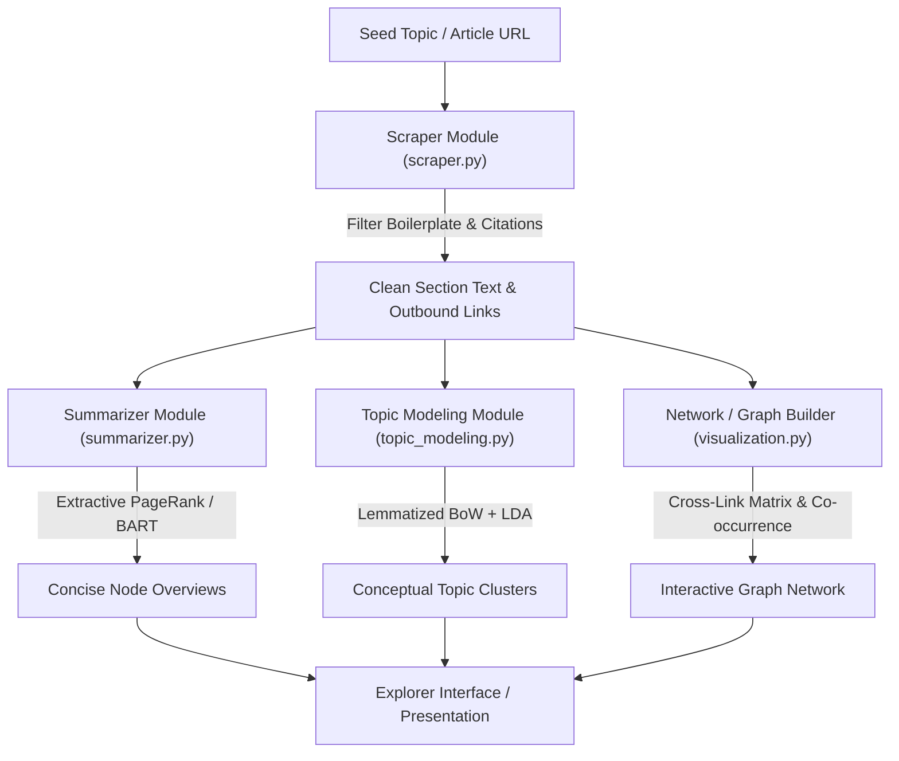

# Dynamic Concept Explorer: Visualizing and Summarizing Wikipedia Topic Networks

[](https://www.python.org/)
[](https://github.com/astral-sh/uv)

An interactive, graph-based knowledge exploration system that ingests arbitrary seed topics from Wikipedia, traverses semantic relationships, prunes topic graphs, and enriches nodes with automated summaries and topic classifications.

> For the original non-technical course proposal, see [docs/PROJECT_PROPOSAL.md](docs/PROJECT_PROPOSAL.md).

---

## 1. System Overview & Architecture

Navigating complex academic and technical domains on Wikipedia frequently causes cognitive overload due to non-linear hyperlinking and verbose articles. **Dynamic Concept Explorer** addresses this by serving as an automated visual and explanation layer:

1. **Dynamic Ingestion:** Extracts the primary content and outbound conceptual links from any starting topic.
2. **Text Distillation:** Applies graph-based sentence ranking (TextRank / LexRank) and neural abstractive summarization (BART) to generate instant node definitions.
3. **Semantic Modeling & Categorization:** Employs Latent Dirichlet Allocation (LDA) and statistical NLP to categorize concepts into coherent clusters.
4. **Network Visualization:** Synthesizes bidirectional hyperlinked structures into an interactive graph layout.



---

## 2. Technical Pipeline & Modules

The system is structured as a modular Python package located in [`src/dynamic_concept_explorer/`](src/dynamic_concept_explorer):

### 2.1 Information Extraction (`scraper.py`)
* **DOM Parsing:** Targets `div#bodyContent` and `<section>` elements using `BeautifulSoup`.
* **Boilerplate & Noise Filtering:** Uses compiled regular expressions (`r"^(\[\d+\]|\s*)$"`) to strip Wikipedia citation brackets (e.g., `[1]`, `[14]`), administrative namespaces (`Special:`, `Help:`, `File:`), and non-content anchor text.
* **Link & Anchor Tracking:** Extracts both anchor surface forms and clean canonical target URIs (`/wiki/...`) to establish graph candidate edges.

### 2.2 Text Distillation & Summarization (`summarizer.py`)
* **Extractive TextRank:**
  1. Tokenizes input text into sentences using NLTK `sent_tokenize`.
  2. Builds sentence TF-IDF feature representations $\mathbf{v}_i \in \mathbb{R}^{|V|}$ using `TfidfVectorizer(stop_words='english')`.
  3. Computes the sentence-to-sentence cosine similarity matrix $\mathbf{S}$ with diagonal zeroed ($\mathbf{S}_{ii} = 0$):

$$
\mathbf{S}_{ij} = 
\begin{cases} 
\dfrac{\mathbf{v}_i \cdot \mathbf{v}_j}{\|\mathbf{v}_i\|_2 \|\mathbf{v}_j\|_2} & \text{if } i \neq j \\
0 & \text{if } i = j 
\end{cases}
$$

  4. Constructs a weighted undirected `networkx.Graph` and computes sentence PageRank scores $\mathrm{PR}(s_i)$ matching `nx.pagerank`:

$$
\mathrm{PR}(s_i) = \frac{1-d}{N} + d \sum_{s_j \in \mathcal{N}(s_i)} \frac{\mathbf{S}_{ji}}{\sum_{s_k \in \mathcal{N}(s_j)} \mathbf{S}_{jk}} \mathrm{PR}(s_j)
$$

     where $N$ is the number of sentences, $d = 0.85$ is the damping factor, and $\mathcal{N}(s_i)$ denotes sentence $s_i$'s adjacent neighbors.
  5. Selects top-$k$ sentences based on target compression ratio $k = \max(1, \min(N, \mathrm{round}(N \cdot r)))$ (default $r = 0.28$) and restores original chronological sentence order.
* **LexRank:** Estimates IDF across a background sentence corpus and extracts salient central sentences with cosine thresholding.
* **Neural Seq2Seq (BART):** Employs `facebook/bart-large-cnn` for neural abstractive summarization with input token length validation (1024 token boundary detection).

### 2.3 Topic Modeling & Categorization (`topic_modeling.py`)
* **Text Preprocessing:** Tokenization via `gensim.utils.simple_preprocess` (de-accenting, punctuation removal, length $\ge 3$), followed by two-pass WordNet lemmatization (verb + noun passes) and stopword removal.
* **Statistical Vocabulary Pruning:** Builds a `gensim.corpora.Dictionary` and filters extreme terms (`no_below=5`, `no_above=0.5`).
* **Unsupervised Topic Discovery:** Fits an unsupervised Latent Dirichlet Allocation (LDA) model to assign thematic distribution vectors across retrieved concept documents:

$$
P(w \mid d) = \sum_{k=1}^K P(w \mid z = k) \cdot P(z = k \mid d) = \sum_{k=1}^K \phi_{k, w} \cdot \theta_{d, k}
$$

  where $\theta_{d, k}$ is the probability of topic $k$ in document $d$, and $\phi_{k, w}$ is the probability of word $w$ under topic $k$.

### 2.4 Graph Construction & Visualization (`visualization.py`)
* **Section Keywords WordClouds:** Computes word clouds per topic section using exact visual configurations (`width=800, height=400, collocations=False`).
* **Co-occurrence & Link Networks:** Generates NetworkX graph topologies with degree-weighted node sizing ($\mathrm{size}(v) = 20 \cdot \mathrm{deg}(v)$) and spring layout positioning.

---

## 3. Quickstart & Setup

The project is managed using [`uv`](https://github.com/astral-sh/uv) for fast, reproducible dependency resolution.

### Prerequisites
* Python 3.11+
* [`uv`](https://docs.astral.sh/uv/) (recommended) or standard `pip`

### Installation

1. **Clone the repository:**
   ```bash
   git clone git@github.com:khemingkapat/dynamic_concept_explorer.git
   cd dynamic_concept_explorer
   ```

2. **Install dependencies and sync environment:**
   ```bash
   uv sync
   ```

3. **Verify baseline modules:**
   ```bash
   uv run python verify_baseline.py
   ```

---

## 4. Implementation Roadmap

| Phase | Milestone | Focus Areas |
| :--- | :--- | :--- |
| **Phase 1** | **Data Retrieval & Graph Pruning** | Implement 2-pass candidate outbound ranking and in-degree thresholding to prevent graph explosion. |
| **Phase 2** | **Summarization & Node Profiling** | Refine TextRank lead-section scoring and compare extractive summaries against Wikipedia lead abstracts. |
| **Phase 3** | **Interactive Visualization** | Build an interactive front-end (e.g., Streamlit / PyVis) with dynamic node expansion and summary popovers. |
| **Phase 4** | **Evaluation & Presentation** | Evaluate topic coherence ($C_v$), summarization ROUGE metrics, and compile final project deliverables. |
