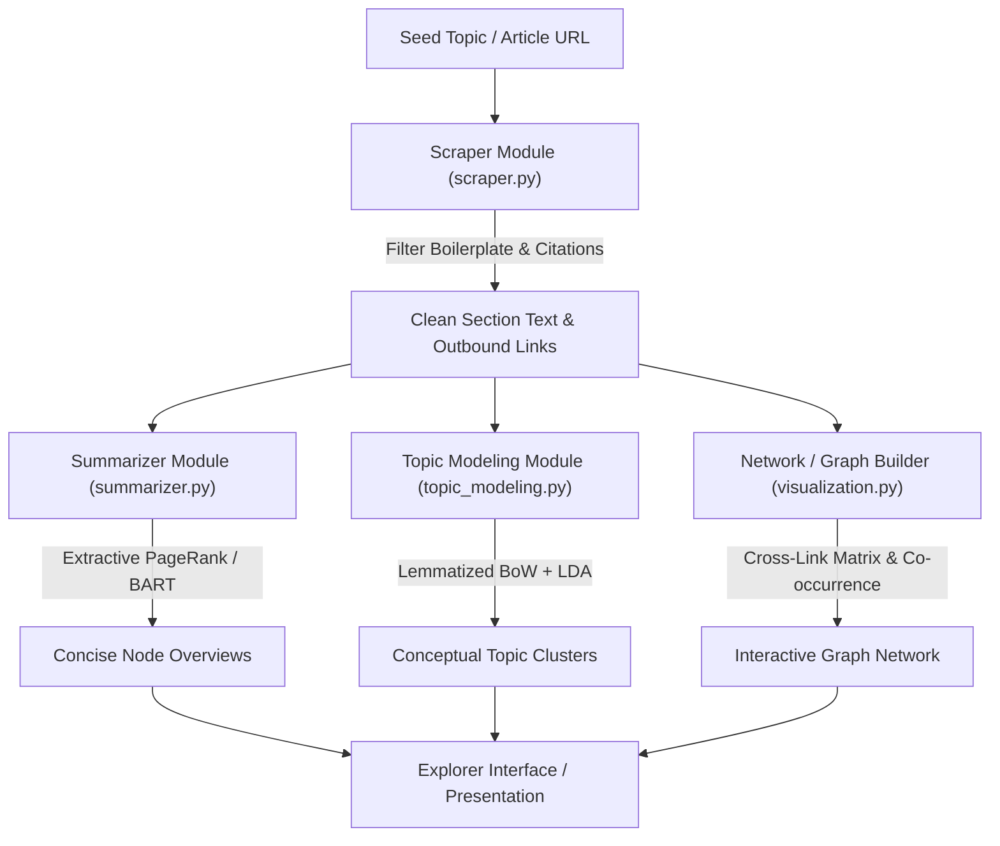

# Dynamic Concept Explorer: Visualizing and Summarizing Wikipedia Topic Networks

[](https://www.python.org/)
[](https://nixos.org/)
[](https://github.com/astral-sh/uv)

An interactive, graph-based knowledge exploration system that ingests arbitrary seed topics from Wikipedia, traverses semantic relationships, prunes topic graphs, and enriches nodes with automated summaries and topic classifications.

> For the original non-technical course proposal, see [docs/PROJECT_PROPOSAL.md](docs/PROJECT_PROPOSAL.md).

---

## 1. System Overview & Architecture

Navigating complex academic and technical domains on Wikipedia frequently causes cognitive overload due to non-linear hyperlinking and verbose articles. **Dynamic Concept Explorer** addresses this by serving as an automated visual and explanation layer:

1. **Dynamic Ingestion:** Extracts the primary content and outbound conceptual links from any starting topic.
2. **Text Distillation:** Applies graph-based sentence ranking (TextRank / LexRank) and neural abstractive summarization (BART) to generate instant node definitions.
3. **Semantic Modeling & Categorization:** Employs Latent Dirichlet Allocation (LDA) and statistical NLP to categorize concepts into coherent clusters.
4. **Network Visualization:** Synthesizes bidirectional hyperlinked structures into an interactive graph layout.



---

## 2. Technical Pipeline & Modules

The system is structured as a modular Python package located in [`src/dynamic_concept_explorer/`](src/dynamic_concept_explorer):

### 2.1 Information Extraction (`scraper.py`)
* **DOM Parsing:** Targets `div#bodyContent` and `<section>` elements using `BeautifulSoup`.
* **Boilerplate & Noise Filtering:** Uses compiled regular expressions (`r"^(\[\d+\]|\s*)$"`) to strip Wikipedia citation brackets (e.g., `[1]`, `[14]`), administrative namespaces (`Special:`, `Help:`, `File:`), and non-content anchor text.
* **Link & Anchor Tracking:** Extracts both anchor surface forms and clean canonical target URIs (`/wiki/...`) to establish graph candidate edges.

### 2.2 Text Distillation & Summarization (`summarizer.py`)
* **Extractive TextRank:**
  1. Tokenizes input text into sentences using NLTK `sent_tokenize`.
  2. Builds sentence representations using `TfidfVectorizer(stop_words='english')`.
  3. Computes the sentence-to-sentence cosine similarity matrix $\mathbf{S}_{i,j} = \cos(\mathbf{v}_i, \mathbf{v}_j)$ with diagonal zeroed ($\mathbf{S}_{i,i} = 0$).
  4. Constructs a weighted undirected `networkx.Graph` and computes sentence PageRank scores:
     $$P(s_i) = \frac{1-d}{N} + d \sum_{s_j \in \text{Adj}(s_i)} \frac{\mathbf{S}_{j,i}}{\sum_{s_k \in \text{Adj}(s_j)} \mathbf{S}_{j,k}} P(s_j)$$
  5. Selects top-$k$ sentences based on a target compression ratio (default $r = 0.28$) and restores original chronological sentence order.
* **LexRank:** Estimates IDF across a background sentence corpus and extracts salient central sentences with cosine thresholding.
* **Neural Seq2Seq (BART):** Employs `facebook/bart-large-cnn` for neural abstractive summarization with input token length validation (1024 token boundary detection).

### 2.3 Topic Modeling & Categorization (`topic_modeling.py`)
* **Text Preprocessing:** Tokenization via `gensim.utils.simple_preprocess` (de-accenting, punctuation removal, length $\ge 3$), followed by two-pass WordNet lemmatization (verb + noun passes) and stopword removal.
* **Statistical Vocabulary Pruning:** Builds a `gensim.corpora.Dictionary` and filters extreme terms (`no_below=5`, `no_above=0.5`).
* **Unsupervised Topic Discovery:** Fits an unsupervised Latent Dirichlet Allocation (LDA) model to assign thematic distribution vectors across retrieved concept documents:
  $$p(w \mid d) = \sum_{t=1}^T p(w \mid t) \cdot p(t \mid d)$$

### 2.4 Graph Construction & Visualization (`visualization.py`)
* **Section Keywords WordClouds:** Computes word clouds per topic section using exact visual configurations (`width=800, height=400, collocations=False`).
* **Co-occurrence & Link Networks:** Generates NetworkX graph topologies with degree-weighted node sizing ($20 \cdot \text{deg}(v)$) and spring layout positioning.

---

## 3. Development Environment & Setup

The project uses [Nix](https://nixos.org/) for reproducible system libraries and [uv](https://github.com/astral-sh/uv) for fast, isolated Python package management.

### Prerequisites
* Nix with flakes enabled (optional, but recommended via `direnv`)
* Python 3.11+
* `uv` package manager

### Installation

1. **Clone and enter the directory:**
   ```bash
   cd dynamic_concept_explorer
   ```

2. **Allow direnv (if using Nix):**
   ```bash
   direnv allow
   ```

3. **Install dependencies and sync environment:**
   ```bash
   uv sync
   ```

4. **Verify baseline modules:**
   ```bash
   uv run python verify_baseline.py
   ```

### Interactive Dev Environment (Zellij)
If you use [Zellij](https://zellij.dev/), launch the workspace layout defined in [`dev.kdl`](dev.kdl):
```bash
zellij --layout dev.kdl
```
This spawns:
* Tab 1: Neovim editor
* Tab 2: Agent CLI terminal
* Tab 3: Terminal with floating JupyterLab server (`uv run jupyter lab`)

---

## 4. Implementation Roadmap

| Phase | Milestone | Focus Areas |
| :--- | :--- | :--- |
| **Phase 1** | **Data Retrieval & Graph Pruning** | Implement 2-pass candidate outbound ranking and in-degree thresholding to prevent graph explosion. |
| **Phase 2** | **Summarization & Node Profiling** | Refine TextRank lead-section scoring and compare extractive summaries against Wikipedia lead abstracts. |
| **Phase 3** | **Interactive Visualization** | Build an interactive front-end (e.g., Streamlit / PyVis) with dynamic node expansion and summary popovers. |
| **Phase 4** | **Evaluation & Presentation** | Evaluate topic coherence ($C_v$), summarization ROUGE metrics, and compile final project deliverables. |
