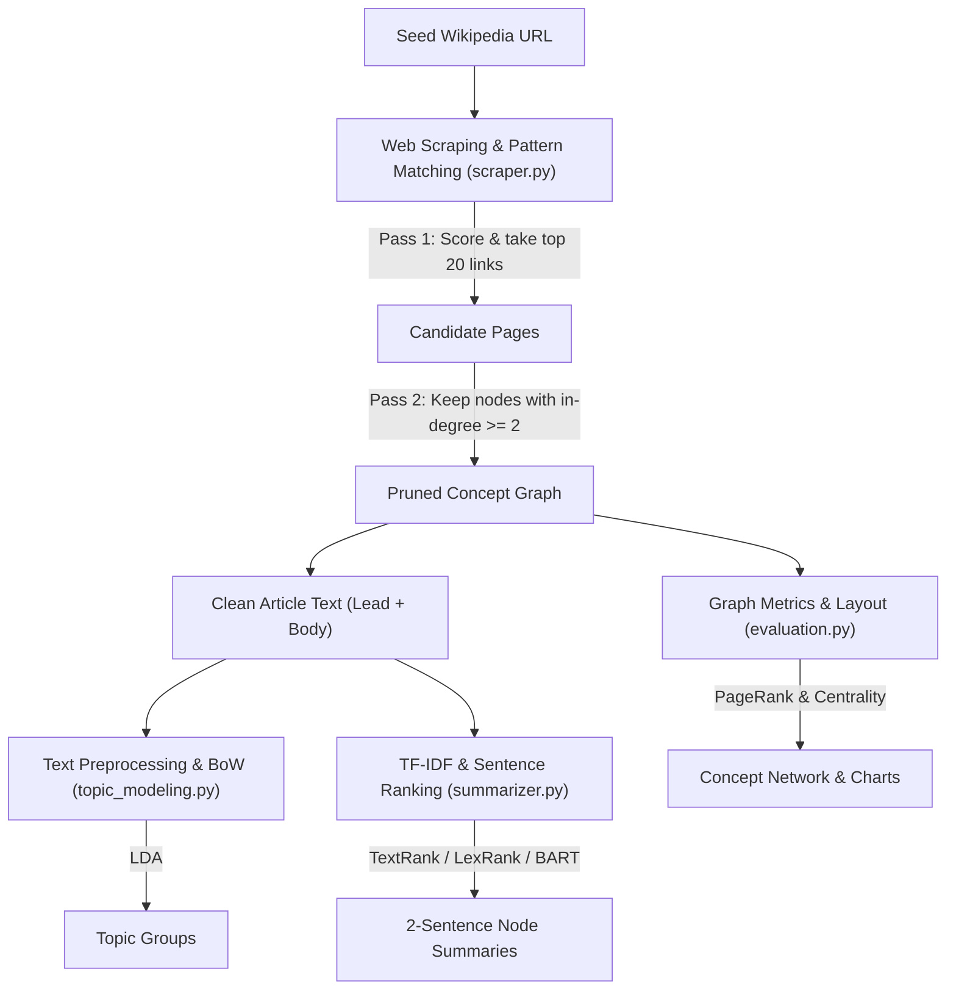
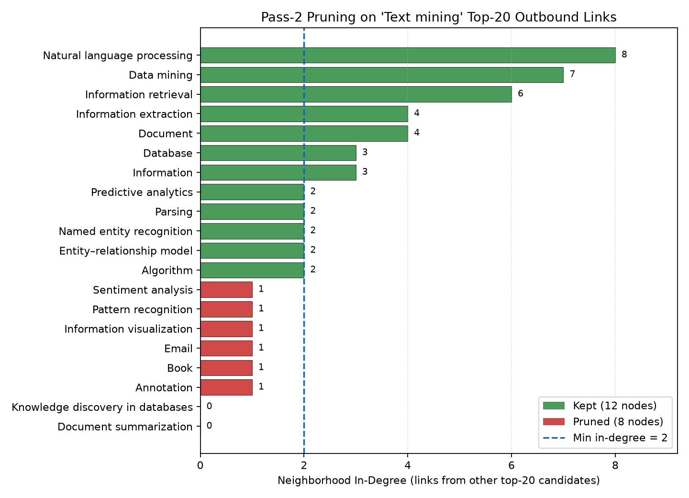
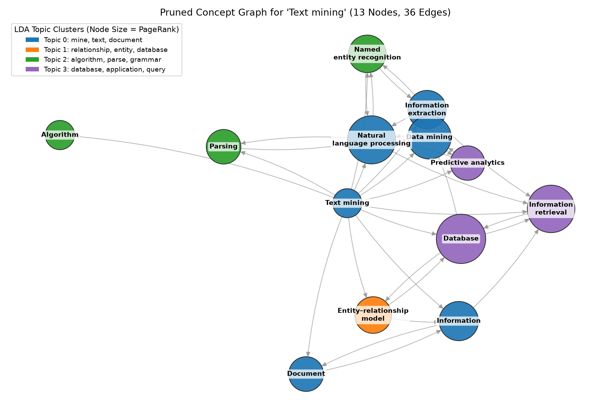
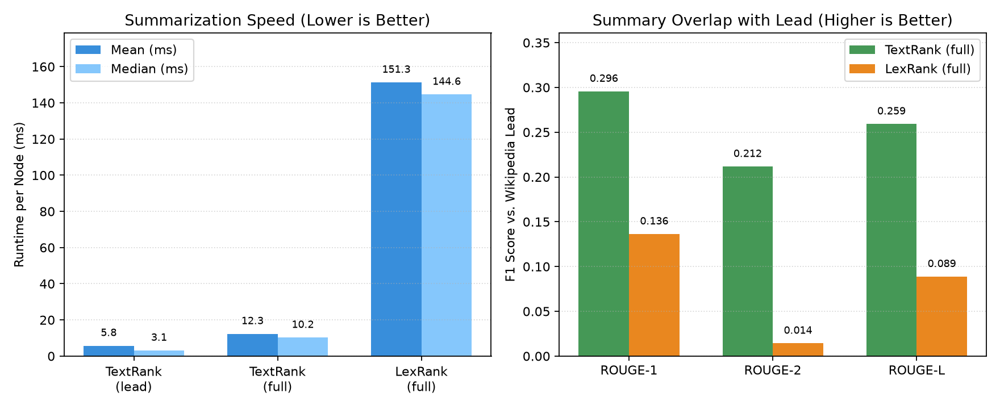

# Dynamic Concept Explorer: Applying Text Analytics to Everyday Learning

## 1. Introduction

### 1.1 Background and Intent

Most text analytics projects start with a fixed dataset—such as a CSV of product reviews—and run models to produce a one-time analysis. **Dynamic Concept Explorer** takes a different approach. Instead of analyzing a static dataset, this project is an **experimental workflow and prototype tool** built to answer a simple, practical question:

> *"How can the text analytics techniques we learned in class help us in a day-to-day task?"*

One common day-to-day task for students and researchers is **learning a new topic on Wikipedia**. A single Wikipedia article often links to dozens of other articles. Opening tab after tab makes it easy to lose track of how concepts connect, and reading full pages just to get basic definitions takes too much time.

To test whether text analytics can solve this problem, we built a pipeline that starts from any Wikipedia link, collects its related pages, removes noisy links, groups the concepts into themes, writes short summaries for each concept, and checks the results with numbers and charts. Our goal is **not** just to run every method we learned, but to **find out which techniques actually work well for a fast, everyday tool—and which ones do not**.

### 1.2 Objectives

1. **Dynamic Data Collection:** Build a small, clean concept network from any starting Wikipedia page without collecting a static dataset beforehand.
2. **Simple Concept Summaries:** Compare extractive methods (TextRank, LexRank) and an abstractive model (BART) to see which gives fast, clear 2-sentence definitions.
3. **Automatic Topic Grouping:** Use Latent Dirichlet Allocation (LDA) to group related concepts into themes without manual labels.
4. **Evaluation:** Check graph structure, topic coherence ($C_v$), summary quality (ROUGE), and runtime speed to see what fits a real-time learning tool.

---

## 2. System Pipeline and Course Concepts

Our system connects the core topics from our Text Analytics lectures—**Web Crawling**, **Web Scraping**, **Pattern Matching**, **Text Preprocessing**, **Text Feature Representation**, **Topic Modeling**, **Text Summarization**, and **Text Visualization**—into one pipeline:

---

## 3. Data Collection and Preprocessing

Instead of downloading a static dataset, our pipeline builds a fresh dataset on demand from a seed Wikipedia page ([`scraper.py`](../src/dynamic_concept_explorer/scraper.py)).

### 3.1 Web Crawling and Scraping (2-Pass Discovery)

Given a seed URL (for example, `https://en.wikipedia.org/wiki/Text_mining`), the scraper sends an HTTP `GET` request, reads `div#bodyContent` with `BeautifulSoup`, and runs two passes:

1. **Pass 1 — Ranking Outbound Links:**
   The scraper collects internal `/wiki/...` links and uses **regex pattern matching** to strip URL fragments (`#...`), remove non-article pages (`Special:`, `Help:`, `File:`, `Category:`), and skip boilerplate sections (`See also`, `References`, `External links`, `Notes`, `Further reading`, `Bibliography`, `Sources`). Each link is scored so that links in the opening summary (`in_lead`) and repeated links score higher:

$$
\text{score}(v) = 2 \cdot \text{in\_lead}(v) + \ln(1 + \text{count}(v))
$$

   Only the top $k = 20$ candidate links are kept.

2. **Pass 2 — Pruning Weak Links:**
   The scraper fetches those 20 pages (using a local JSON cache in `.cache/wiki/` so repeated runs are fast) and counts how many of the other top-20 pages link back to each candidate (**in-degree**). Any page with $\text{in\_degree} < 2$ is removed, unless fewer than 5 nodes would remain (`min_nodes = 5`). This stops the graph from growing out of control.

### 3.2 Text Cleaning and Preprocessing

For each kept page, we extract clean paragraph text and split it at the first `<h2>` heading into `lead` (the opening summary) and `body` (the rest of the article). Citation brackets (`[1]`, `[citation needed]`), math tags, edit links, and infoboxes are removed.

Before running LDA ([`topic_modeling.py`](../src/dynamic_concept_explorer/topic_modeling.py)), we apply standard **Text Preprocessing**:

1. **Tokenization:** Split text into lowercase words of length $\ge 3$ and remove punctuation using `gensim.utils.simple_preprocess`.
2. **Lemmatization:** Convert words to their base form using WordNet (verbs first, then nouns).
3. **Stopword Removal:** Remove common English stopwords (plus optional topic-specific words).
4. **Bag-of-Words (BoW) Filtering:** Keep words that appear in at least 2 documents (`no_below=2`) and in at most 85% of documents (`no_above=0.85`). If a small graph becomes empty, fall back to `no_below=1, no_above=1.0`.

---

## 4. Methods Tested ("What Fits and Why")

### 4.1 Text Summarization (2-Sentence Node Overviews)

We tested three summarization methods ([`summarizer.py`](../src/dynamic_concept_explorer/summarizer.py)) to generate a short **2-sentence overview** for each node:

* **TextRank (Default):** Splits text into sentences (keeping sentences of 6–60 words, up to 250 sentences), converts sentences into **TF-IDF** vectors, builds a cosine similarity matrix $\mathbf{S}$ with $\mathbf{S}_{ii} = 0$, and runs PageRank ($d = 0.85$) to pick the top 2 sentences in original order. We tested both the **lead section** (`scope="lead"`) and the **full article** (`scope="full"`).
* **LexRank:** Computes sentence centrality with a cosine threshold of $0.25$.
* **BART (`facebook/bart-large-cnn`):** A neural sequence-to-sequence model tested on demand (trimmed to 2 complete sentences, with automatic fallback to TextRank if unavailable).

### 4.2 Topic Modeling (LDA)

We use **Latent Dirichlet Allocation (LDA)** (`num_topics=4`, `passes=10`, `alpha="symmetric"`) on the Bag-of-Words corpus to group the active pages into 4 themes. Each node gets its highest-probability topic and confidence score.

### 4.3 Graph Metrics and Evaluation

We evaluate the pipeline ([`evaluation.py`](../src/dynamic_concept_explorer/evaluation.py)) using three sets of metrics:

* **Graph Topology:** Node count, edge count, density, average clustering coefficient, reciprocity, PageRank, in-degree centrality, and betweenness centrality.
* **Topic Quality:** Gensim $C_v$ topic coherence (`top_n=10`).
* **Summary Quality:** Macro-averaged **ROUGE-1, ROUGE-2, and ROUGE-L** (F1) comparing full-article summaries (`TextRank-full`, `LexRank-full`) against each article's Wikipedia lead section as a reference. (`TextRank-lead` picks sentences directly from the lead, so scoring it against the lead would be circular.)

---

## 5. Preliminary Results: `Text_mining` Case Study

To test the whole pipeline on a topic from our course, we ran it on **`https://en.wikipedia.org/wiki/Text_mining`**.

### 5.1 Pruning and Dataset Size

| Metric | Result | Notes |
| :--- | :---: | :--- |
| **Pass-1 Candidates** | 20 | Top 20 outbound links from `Text_mining` |
| **Kept Nodes (Pass 2)** | 12 | Nodes with `in_degree >= 2` |
| **Pruned Nodes** | 8 | Nodes with `in_degree < 2` |
| **Final Graph** | 13 nodes, 36 edges | Seed + 12 kept neighbors |
| **Total Words Fetched** | 30,836 words | Across 13 articles |
| **Full Article Length** | 841 – 6,667 words | Median: 2,296 words |
| **Lead Section Length** | 62 – 604 words | Median: 221 words |

**What this shows:** Pass-2 pruning cleanly removed generic links like `Book` (1), `Email` (1), and `Annotation` (1). However, it also removed relevant subtopics like `Sentiment analysis` (1) and `Document summarization` (0) because few of the other top-20 pages linked to them. This shows a clear trade-off between keeping the graph small and keeping niche subtopics.

### 5.2 Graph Structure and LDA Topics

For the 13-node, 36-edge graph, **density is `0.2308`**, **average clustering is `0.6296`**, and **reciprocity is `0.4444`** (almost half of the links go both ways).

| Node | PageRank | In-Degree Centrality | Betweenness Centrality | Role |
| :--- | :---: | :---: | :---: | :--- |
| `/wiki/Database` | **0.1608** | 0.1667 | **0.3598** | Bridge node |
| `/wiki/Natural_language_processing` | 0.1498 | **0.5000** | 0.2727 | Main hub |
| `/wiki/Information_retrieval` | 0.1441 | 0.4167 | 0.3030 | Hub & bridge |
| `/wiki/Data_mining` | 0.1095 | 0.3333 | 0.2348 | Main hub |
| `/wiki/Information` | 0.0776 | 0.2500 | 0.1402 | Supporting node |

After preprocessing and filtering, the LDA dictionary had **1,344 words**. Running 4-topic LDA gave a **mean $C_v$ coherence of `0.4619`**:

| Topic | $C_v$ Coherence | Top Keywords | Assigned Nodes (Count) |
| :--- | :---: | :--- | :--- |
| **Topic 0** | 0.4230 | `mine`, `text`, `document`, `pattern`, `analysis` | `Text_mining`, `Natural_language_processing`, `Data_mining`, `Document`, `Information_extraction`, `Information` (6) |
| **Topic 1** | 0.5455 | `relationship`, `entity`, `database`, `type`, `represent` | `Entity–relationship_model` (1) |
| **Topic 2** | 0.3974 | `algorithm`, `parse`, `grammar`, `sentence`, `entity` | `Named_entity_recognition`, `Parsing`, `Algorithm` (3) |
| **Topic 3** | 0.4817 | `database`, `application`, `query`, `relational`, `use` | `Information_retrieval`, `Database`, `Predictive_analytics` (3) |

**What this shows:** Even with only 13 articles, LDA separated **parsing/algorithms** (Topic 2) from **databases/retrieval** (Topic 3) and **core text mining** (Topic 0). At the same time, Topic 1 shows a weakness of LDA on small corpora: a single specialized page (`Entity–relationship_model`) formed its own 1-node topic.

### 5.3 Summarization Speed and Quality

**Sample Outputs for `/wiki/Text_mining`:**

* **TextRank (`lead`):** *"Text mining, text data mining (TDM) or text analytics is the process of deriving high-quality information from text. (2005), there are three perspectives of text mining: information extraction, data mining, and knowledge discovery in databases (KDD)."*
* **TextRank (`full`):** *"Text mining, text data mining (TDM) or text analytics is the process of deriving high-quality information from text. Text analytics describes a set of linguistic, statistical, and machine learning techniques that model and structure the information content of textual sources for business intelligence, exploratory data analysis, research, or investigation."*
* **LexRank (`full`):** *"Text mining is also used in some email spam filters as a way of determining the characteristics of messages that are likely to be advertisements or other unwanted material. Text mining plays an important role in determining financial market sentiment."*

**What this shows:**

1. **TextRank works much better than LexRank here:** `TextRank (full)` ran **over 10x faster** (mean 12.3 ms vs. 151.3 ms) and scored much higher on ROUGE-2 (`0.212` vs. `0.014`). LexRank often picked mid-article examples (like spam filters) instead of the main definition.
2. **TextRank (`lead`) is the fastest option (~3–6 ms per node),** though stripping `[1]` citations can occasionally leave small text artifacts like `(2005), there are...`.
3. **BART is too slow for real-time graphs on CPU:** In our 6-topic test logged in [`INCREMENTAL_LOG.md`](INCREMENTAL_LOG.md), `facebook/bart-large-cnn` took **3.4–14.1 seconds per node** on CPU (compared to 3–20 ms for TextRank-lead) and skipped the opening definition in 2 out of 6 topics. Because a 13–20 node graph would take minutes to summarize with BART, it is kept on demand only.

---

## 6. Conclusion, Limitations, and Future Work

### 6.1 Conclusion

Testing our course methods on an everyday Wikipedia learning task showed that **simple, fast methods fit interactive tools much better than heavy models**:

* **2-Pass In-Degree Pruning + PageRank** turns messy Wikipedia links into a clean, small concept map and highlights the most important hub and bridge topics.
* **TextRank** gives fast (~5–15 ms), clear definitions and beats both LexRank and CPU-based BART for this use case.
* **LDA** gives helpful topic groupings ($C_v = 0.4619$ on `Text_mining`), even on small dynamic graphs, as long as the number of topics stays small.

### 6.2 Limitations

1. **Cleaning Artifacts:** Removing math tags can leave gaps in formula-heavy pages, and removing `[1]` brackets can leave stray year parentheses like `(2005), ...`.
2. **Strict Pruning Drops Niche Subtopics:** Requiring `in_degree >= 2` removes generic noise (`Book`, `Email`) but can also drop useful subtopics (`Sentiment_analysis`, `Document_summarization`).
3. **Small-Corpus LDA:** With only 10–20 documents, LDA can create 1-node topics for specialized pages.

### 6.3 Future Work

1. **Interactive Web UI:** Connect the pipeline (`discover_neighborhood`, `fetch_neighborhood_documents`, `summarize_node`, `cluster_topic_nodes`) to an interactive graph interface where users can click nodes to read summaries, filter by topic, and expand new seed topics.
2. **Better Text Cleaning:** Keep math `alttext` and remove leftover citation fragments like `(2005)`.
3. **Flexible Pruning & Topic Count:** Test automatic selection of `num_topics` using $C_v$ coherence and allow high-scoring Pass-1 links to stay even if their in-degree is 1.

---

## 7. References

1. Mihalcea, R., & Tarau, P. (2004). *TextRank: Bringing Order into Text*. EMNLP 2004, 404–411.
2. Erkan, G., & Radev, D. R. (2004). *LexRank: Graph-based Lexical Centrality as Salience in Text Summarization*. Journal of Artificial Intelligence Research, 22, 457–479.
3. Lewis, M., et al. (2020). *BART: Denoising Sequence-to-Sequence Pre-training for Natural Language Generation, Translation, and Comprehension*. ACL 2020, 7871–7880.
4. Blei, D. M., Ng, A. Y., & Jordan, M. I. (2003). *Latent Dirichlet Allocation*. Journal of Machine Learning Research, 3, 993–1022.
5. Röder, M., Both, A., & Hinneburg, A. (2015). *Exploring the Space of Topic Coherence Measures*. WSDM 2015, 399–408.
6. Lin, C.-Y. (2004). *ROUGE: A Package for Automatic Evaluation of Summaries*. ACL Workshop on Text Summarization Branches Out, 74–81.
7. Hagberg, A. A., Schult, D. A., & Swart, P. J. (2008). *Exploring Network Structure, Dynamics, and Function using NetworkX*. SciPy 2008, 11–15.
8. Řehůřek, R., & Sojka, P. (2010). *Software Framework for Topic Modelling with Large Corpora*. LREC 2010 Workshop on New Challenges for NLP Frameworks, 45–50.
